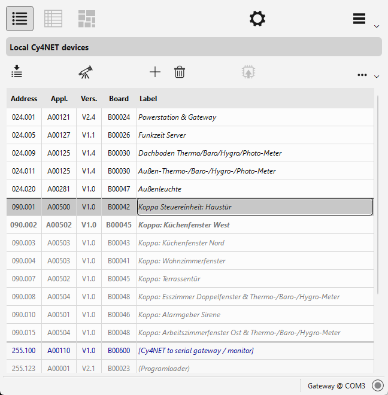
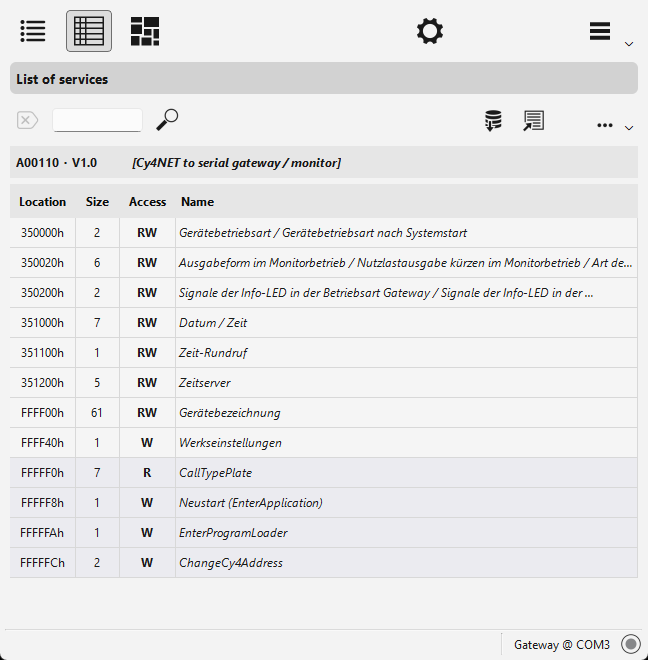
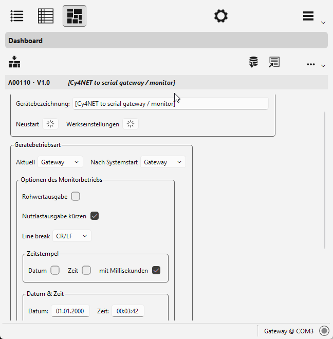
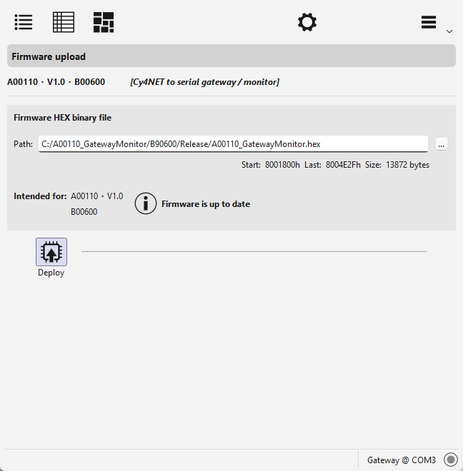
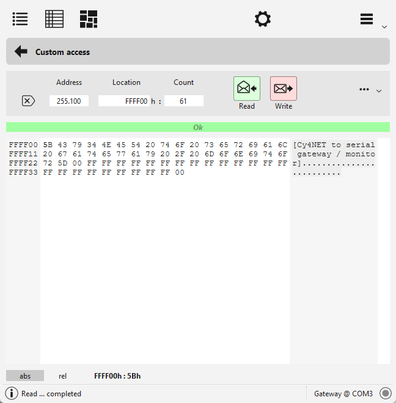

# Cy4Tool

Ein leistungsstarkes PC-Werkzeug für die Administration, Konfiguration und Instandhaltung von **Cy4NET-Komponenten** des freien Peer-To-Peer Kommunikationssystems Cy4NET: https://cy4net.org

## Über die Anwendung

**Cy4Tool** wurde entwickelt, um Anwendern die Handhabung von Cy4NET-Buskomponenten in einem Cy4NET-Netzwerk zu erleichtern. Die Anwendung bündelt wichtige Diagnose-, Wartungs- und Verwaltungsfunktionen in einer übersichtlichen Desktop-Oberfläche. Um mit den Teilnehmern des Cy4NET-Netzwerks in Kontakt zu treten, verbindet sich die Anwendung als Busclient über ein entsprechendes Gateway-Gerät mit dem Bus. Je nach vorhandener Hardware kann die Verbindung mittels USB, RS232 oder TCP hergestellt werden. 

Die Eigenschaften und Funktionen einer Anwendung sind im Cy4NET-Protokoll in Form von Diensten organisiert. Diese Dienste sind im Grunde eine Abstraktion von Speicherbereichen, die beschrieben oder gelesen werden können. Welche Informationen und Datenstrukturen dabei übertragen werden, ist jeweils mit dem Dienst definiert. Mithilfe des Cy4Tools können diese Dienste zur Kontaktierung der Busknoten genutzt werden.
Die Funktionalität einer Anwendung wird dabei durch eine sogenannte Dienstekarte (Servicemap) abgebildet. Neben den Diensten der Anwendung ist darin auch eine Oberfläche mit Steuerelementen und Widgets definiert, die den Zugriff auf die Komponenten erleichtern. Das Cy4Tool ist somit das Frontend der Cy4NET-Geräte und als basisnahe Serviceschnittstelle zu verstehen.

Auf der Cy4NET-Projekteseite sind mehrere Gateways zu finden. Darunter auch Geräte, die die Funktion eines Gateways als Zusatzleistung bereitstellen.
* https://cy4net.org/Axxxxx/A00111_GatewayMonitor/A00111Home.html
* https://cy4net.org/Axxxxx/A00121_Powerstation/A00121Home.html
* https://cy4net.org/Axxxxx/A00317_Evalboard644PKit/A00317Home.html

### Hauptfunktionen
* **Liste aller verfügbaren Cy4NET-Geräte im Netzwerk**.

  Neben der Adresse und der Applikations- sowie Boardtypennummer wird auch die Gerätebezeichnung angegeben (insofern die Anwendung eine liefert):
  
  
* **Liste der Dienste einer Applikation.**

  Die Dienstekarte liefert die von einer Applikation bereitgestellten Dienste. In der ersten Spalte ist der Dienstort (Location) zu sehen, gefolgt von der Dienstebreite. Das ist die Anzahl der zum Dienst gehörenden Speicherzellen in Bytes. In der dritten Spalte ist die Zugriffsart zu sehen, gefolgt vom Namen des Dienstes. Das Cy4Tool liest alle Dienste der Dienstekarte ein, konsolidiert sie und stellt somit diese Liste zusammen.
  
  
 
* **Bedienfeldseite**

  In der Dienstekarte einer Applikation wird neben den Diensten auch ein einfaches Bedienfeld festgelegt, über das auf die eigentlichen Funktionen der Anwendung zugegriffen werden kann. Dazu definiert die Dienstekarte eine hierarchische Struktur aus verschiedenen Steuerelementen (Widgets), die die entsprechende Funktionalität bereitstellen.
 
  
  
  Neben diesen Hauptfunktionen ermöglicht das Cy4Tool weitere Hilfsaufgaben wie beispielsweise das Hochladen von Firmwareupdates oder den Direktzugriff auf Daten der Dienste.

  
  

## Voraussetzungen

Um Cy4Tool nutzen zu können, muss dein System folgende Anforderungen erfüllen:
* **Betriebssystem:** Windows 10/11, Linux (Ubuntu 22.04+)
* **Systemanforderungen:** Mindestens 4 GB RAM, 100 MB freier Speicherplatz

## Installation

Für Windows steht eine ausführbare Installationsdatei zur Verfügung: 
> **Hinweis zur Installation:** Da die Datei nicht digital signiert ist, erscheint unter Windows eventuell eine SmartScreen-Warnung. Klicke dort einfach auf **"Weitere Informationen"** und anschließend auf **"Trotzdem ausführen"**.


1. Lade die neueste Version aus dem Bereich [Releases](../../releases) herunter oder klone das Repository:
   ```bash
   git clone https://github.com/RGrasbon/Cy4Tool.git
   ```
2. Cy4Tool ist eine Qt-Anwendung. Öffne CMakeLists.txt in QtCreator oder einer beliebigen IDE, bei der die Biliotheken für Qt6 Widgets zur Verfügung stehen.
   


## Nutzung

1. Verbinde das am Cy4NET angeschlossene Gateway über das Netzwerk, per USB oder über die serielle Schnittstelle mit deinem PC.
2. Starte **Cy4Tool**.
3. Wähle in den Einstellungen die entsprechende Schnittstelle aus und drücke auf „Verbinden”. Wenn ein Gateway gefunden wurde, wird die Geräteliste angezeigt. Das Gateway-Gerät ist blau gekennzeichnet. Fehlende Geräte können nun entweder über die **+**-Schaltfläche oder etwas komfortabler über die Entdecken-Funktion (Discover) in die Liste aufgenommen werden. Zugriffsart und Liste werden gespeichert.

## Mitwirken (Contributing)

Beiträge und Verbesserungsvorschläge sind willkommen! Wenn du einen Fehler findest oder eine Idee für eine neue Funktion hast, erstelle gerne ein **Issue** oder reiche einen **Pull Request** ein. Die Komplette Dokumentantion zum Cy4NET-Protokoll findet sich auf https://cy4net.org. Ebenfalls dort sind bereits bestehende Projekt und Applikationnen zu sehen.

## Lizenz

Dieses Projekt steht unter der **FreeBSD-Lizenz** (2-Clause BSD License). Weitere Details finden sich in der Datei [LICENSE](LICENSE) im Hauptverzeichnis dieses Repositories.
